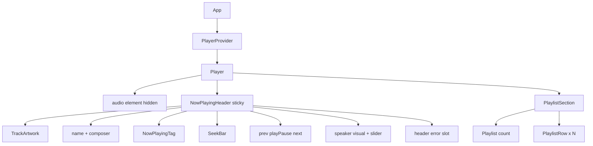
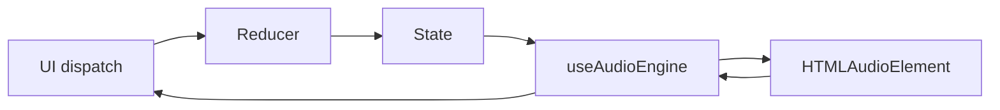

# Pocket FM Audio Player — Architecture

**Status:** Locked stack. Implementation is phased. Do not skip phases. Do not invent answers to open questions in [PRODUCT.md](PRODUCT.md).

**Date:** 2026-11-04

**Product source of truth:** [PRODUCT.md](PRODUCT.md)

**UI source of truth:** [reference/ui-screenshot.png](reference/ui-screenshot.png)

**Audience:** Any human or agent picking up this work.

---

## How to read this doc

- Follow [PRODUCT.md](PRODUCT.md) for *what* to build.
- Follow this file for *how* to structure code, state, and phases.
- Open product questions stay open as product decisions. Implementation may use documented placeholders (browser default volume `1.0`, load-error slot copy) until those questions are decided.

---

## Locked stack

- JavaScript Create React App (existing repo)
- One HTML5 `<audio>` element
- React Context + `useReducer` for player state
- CSS Modules
- No Redux, Zustand, or Tailwind

**Do not build:** shuffle, repeat, row three-dot menus, mute, keyboard handlers.

---

## Component architecture

One player tree. Presentational components do not touch the `<audio>` DOM node. Only `Player` + `useAudioEngine` do.



Track artwork, title/composer, Now Playing tag, and the header error slot live inside `NowPlayingHeader` unless a later phase needs them extracted. They are not required as separate files.

### Files

| Path | Role |
| --- | --- |
| `src/App.js` | Page background; mounts provider + player |
| `src/data/playlist.js` | Mock array of 8 tracks |
| `src/player/playerContext.js` | Context object |
| `src/player/playerReducer.js` | Pure state updates |
| `src/player/PlayerProvider.js` | Initial state from mock playlist |
| `src/player/usePlayer.js` | Read state + dispatch |
| `src/player/useAudioEngine.js` | Sync `<audio>` with state; media events dispatch into the reducer |
| `src/player/formatTime.js` | `m:ss` as in the screenshot (`1:24`, not `01:24`) |
| `src/components/Player/Player.js` + `Player.module.css` | Card; owns the audio ref |
| `src/components/NowPlayingHeader/NowPlayingHeader.js` | Sticky header |
| `src/components/SeekBar/SeekBar.js` | Seek + times |
| `src/components/TransportControls/TransportControls.js` | Previous, play/pause, next |
| `src/components/VolumeControl/VolumeControl.js` | Speaker (visual only) + slider |
| `src/components/PlaylistSection/PlaylistSection.js` | Heading + list |
| `src/components/PlaylistRow/PlaylistRow.js` | One track row |

### Ownership

- `Player` — audio element, layout card, sticky header + list
- Header children — render current track + dispatch play/pause/seek/volume/prev/next
- `PlaylistRow` — render one track; click current → toggle; click other → select-and-play (from Phase 4)
- List row **duration** comes from mock `duration`
- Header **total duration** uses audio metadata when available, otherwise mock duration
- Header **current time** comes from audio `timeupdate` (from Phase 3)

### Mock track shape

```js
{
  id: string,
  name: string,
  composer: string,
  thumbnailUrl: string,
  duration: number, // seconds
  audioUrl: string, // royalty-free, must actually play
}
```

---

## State management

**Why Context + `useReducer`:** one playlist, one current track, header and list both need the same session. No extra library. Reducer stays pure. Media side effects live in `useAudioEngine`.

### State shape

- `tracks` — mock playlist (not edited in v1)
- `currentTrackId`
- `status` — `paused` | `playing`
- `currentTime` — seconds
- `duration` — seconds from audio when known
- `volume` — `0..1` (initial value is **open** in PRODUCT.md; do not pick a number until that is decided)
- `loadError` — `null` or a string (copy is **open** in PRODUCT.md)
- `isSeeking` — true while the user drags the seek bar so `timeupdate` does not fight the thumb
- `isBuffering` — true while playback is requested but audio is still loading/waiting. Main button and current-row indicator show a spinner instead of pause.

### Derived (not stored)

- current track
- current index
- `isFirst` / `isLast`
- formatted times
- `Playlist ({tracks.length})`

### Actions (reducer)

- `PLAY` / `PAUSE` / `TOGGLE_PLAY`
- `SELECT_AND_PLAY` — other row, Previous, Next (when not at ends)
- `SEEK`
- `TIME_UPDATE` / `DURATION_CHANGE`
- `SET_VOLUME`
- `TRACK_ENDED` — `status: paused`, `currentTime: 0`, same `currentTrackId`
- `LOAD_ERROR` / `CLEAR_LOAD_ERROR`
- `SET_BUFFERING`

### Audio engine (side effects only)



- On `currentTrackId` change: set `audio.src`, load, play if the action was select-and-play / prev / next; on first load do **not** autoplay
- On `status`: `play()` / `pause()`
- On `volume`: `audio.volume = volume`
- On `SEEK`: `audio.currentTime = ...`
- `ended` → `TRACK_ENDED` (no next track)
- `error` → `LOAD_ERROR`, stay on that track
- `waiting` / `stalled` (while playing) → `SET_BUFFERING true`
- `playing` → `SET_BUFFERING false`
- `SELECT_AND_PLAY` and Play start with `isBuffering: true` until `playing`
- Previous on first / Next on last: UI does not dispatch `SELECT_AND_PLAY`

Until PRODUCT open questions are answered, do not pick a default volume number or error sentence in code.

---

## Phase-wise implementation

Implement in order. After each phase, run that phase’s manual tests before starting the next.

**Current phase:** Phases 1–6 implemented (2026-11-04). Open product questions still apply.

### Phase 1 — Shell + mock data (no real audio)

Static UI from the screenshot + 8-track mock module. Header bound to the first track by index, not by player state. Buttons visible but inert. No shuffle / repeat / kebab.

No `PlayerProvider`, reducer, or `<audio>` yet.

**Manual tests**

1. Light page background; dark rounded player card.
2. Header stacked above the playlist (mobile and desktop).
3. Header shows first track thumbnail, name, composer, Now Playing pill.
4. Seek bar, `0:00`, mock total duration, prev, play, next, speaker, volume slider are visible.
5. Shuffle, repeat, and row three-dot menus are **absent**.
6. Heading reads `Playlist (8)` (or live count if not exactly 8).
7. Eight rows: thumbnail, name, composer, duration; no track numbers.
8. First row has purple highlight + left play triangle; others do not.
9. Scroll the list: header stays visible (sticky).
10. Narrow the viewport: still stacked header-then-list; no second layout.

### Phase 2 — Selection state (still no sound)

Add `PlayerProvider` + reducer for `tracks`, `currentTrackId`, visual `status`. Clicking a **different** row only **selects** it (header + highlight move). Play/pause icon may toggle visually. **Deviation (remove in Phase 3–4):** no audio yet, so another-row click does not play sound; prev/next only change selection; ends do nothing.

**Manual tests**

1. Load: first track selected, play icon (paused), highlight on row 1.
2. Click row 3: header name/composer/thumbnail update; highlight + triangle move to row 3; Now Playing pill still shown.
3. Click the same current row: play/pause icon toggles; highlight stays.
4. Previous from row 2 selects row 1. Previous on row 1 does nothing.
5. Next on the last row does nothing. Next from row 1 selects row 2.
6. Still no audible playback.

### Phase 3 — Audio engine for the current track

Wire the single `<audio>` element. Load paused. Play/pause and current-row click control **sound**. `ended` resets to `0:00` paused on the same track. Load failure shows the header error slot and does not skip. Times may display from audio metadata (seek dragging is Phase 5).

**Manual tests**

1. Load: no sound; first track paused at `0:00`.
2. Play: audio is audible; button shows pause.
3. Pause: audio stops; button shows play; Now Playing pill remains.
4. Click the current row: toggles sound the same way as the button.
5. Let the track finish: no next track; same row current; paused; time `0:00`.
6. Play after finish: same track starts from the beginning.
7. Point the current track at a bad URL (temporary local change): error appears in the header; player stays on that track; no auto-skip. Revert the URL after the test. **Copy/styling of the error is still an open product question** — only the slot and stay-put behavior are required.

### Phase 4 — Track navigation with play rules

Clicking a **different** row, Previous, and Next use `SELECT_AND_PLAY` (always starts the new track). Ends stay disabled. Changing track clears a previous load error.

**Manual tests**

1. Pause on track 1, press Next: track 2 **plays immediately**.
2. Click a non-current row: that track plays from `0:00`.
3. Previous/Next mid-list move and play from `0:00`.
4. Previous on first and Next on last still do nothing (no wrap, no restart).
5. After a load error, select a valid track: error clears; new track can play.

### Phase 5 — Seek + volume

Seek bar is interactive. Volume slider changes loudness. Speaker does not mute. Initial volume value is **blocked** on PRODUCT open question 1 — do not start this phase until that number is decided.

**Manual tests**

1. While playing, drag/click seek: playback jumps; current time matches the thumb.
2. While paused, seek: playhead/time change; pressing Play continues from there.
3. Left time and right duration stay `m:ss` (`1:24` / `3:56` style).
4. Volume slider up/down changes loudness.
5. Clicking the speaker does **not** mute or unmute.

### Phase 6 — Visual QA against the screenshot

Match [reference/ui-screenshot.png](reference/ui-screenshot.png) (minus omitted controls). Sticky header and stacked responsive layout already from Phase 1; this phase is polish only. Do not invent a mobile layout. Disabled prev/next **look** stays open — keep them non-functional at ends.

**Manual tests**

1. Side-by-side with the screenshot: palette, typography, thumbnail radius, pill, seek thumb, circular play button, row highlight.
2. Omitted controls still absent.
3. Desktop and a narrow mobile width: stacked, header sticky, volume slider still usable (wrapping unspecified — do not add a second design).
4. Smoke: load paused → play → seek → volume → next → pause → let a short track end → error path still stay-put.

---

## Decision log (architecture)

| ID | Decision | Date |
| --- | --- | --- |
| A1 | JavaScript CRA, HTML5 audio, Context + useReducer, CSS Modules. No Redux/Zustand/Tailwind. | 2026-11-04 |
| A2 | One hidden `<audio>` in `Player`. Presentational components never touch it. | 2026-11-04 |
| A3 | Six independently testable phases. Phase 2 may select without sound; that deviation is removed in Phases 3–4. | 2026-11-04 |
| A4 | Docs-only architecture pass first; application code starts at Phase 1 when requested. | 2026-11-04 |
| A5 | Phase 5 volume initial value uses HTMLAudioElement default `1.0` until PRODUCT Q1 is decided. | 2026-11-04 |
| A6 | Load-error slot uses placeholder copy `This track could not be loaded.` until PRODUCT Q3 is decided. | 2026-11-04 |
| A7 | Phases 3–6 implemented together; Phase 2 select-without-sound deviation removed. | 2026-11-04 |
