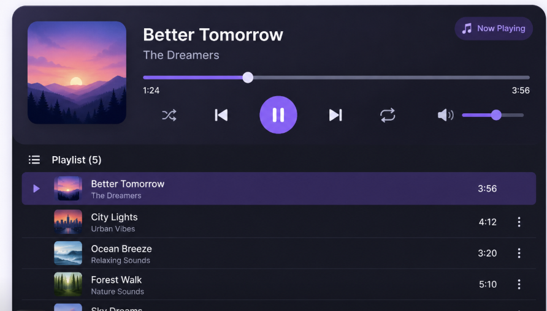
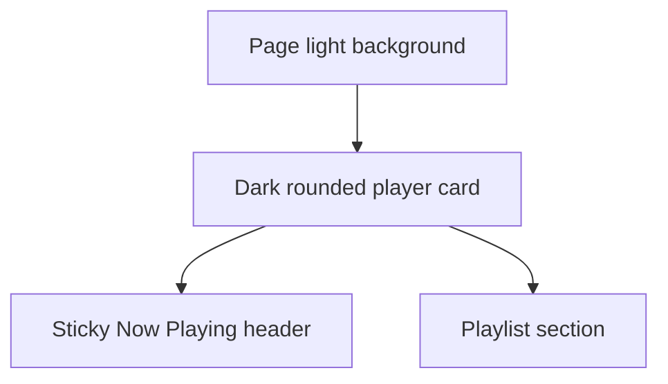
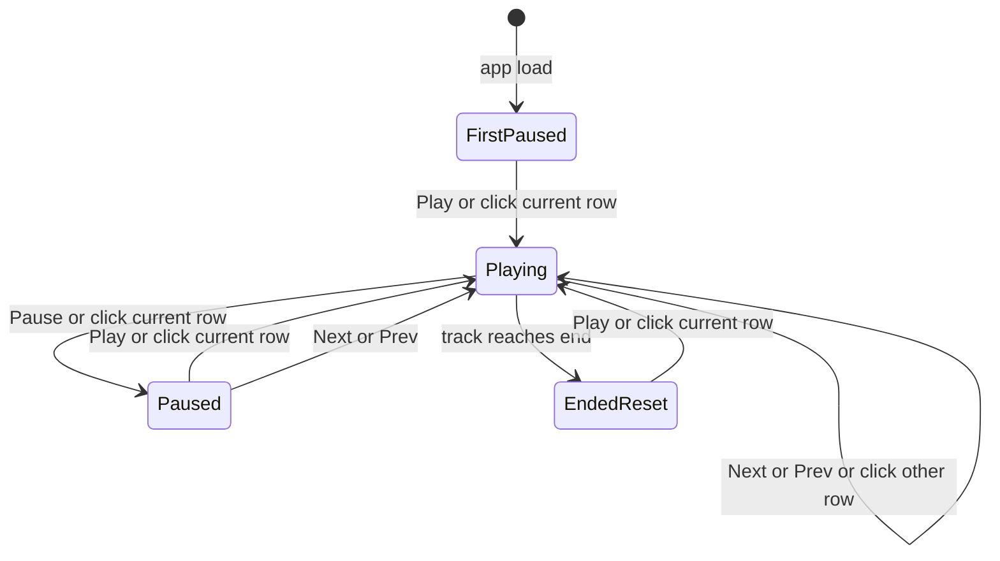

# Pocket FM Audio Player — Product Requirements

**Status:** Requirements captured. Waiting for Chiranshu to freeze this doc. Architecture and implementation must not start until this file is frozen.

**Audience:** Any human or agent picking up this work. Do not invent behavior, visuals, or fields that are not written here.

**Date:** 2026-11-04

**Owner:** Chiranshu

---

## How to read this doc

- **Locked** means a decision was made. Do not change it without an explicit new decision, then update the Decision log.
- **Open** means it is unspecified. Do not assume a value.
- Visuals come from the screenshot. v1 **omits** a few screenshot controls (see Visual spec). Behavior comes from the Q&A, not from guessing what a typical player does.

Reference screenshot (design source):

File: [`docs/reference/ui-screenshot.png`](reference/ui-screenshot.png)

---

## Product summary

A React web audio player. There is **one playlist** that stores all tracks. The user can play **one track at a time**.

The page has two stacked sections:

1. **Sticky header** — the current track (Now Playing), metadata, timings, and playback controls.
2. **Playlist list** — every track in the playlist. The current track is highlighted. Clicking a row plays that track (or toggles play/pause if it is already current).

Data for v1 is a **mock playlist** of about **8** tracks with royalty-free remote URLs that actually play.

The same stacked layout is used on mobile and desktop (it scales; it is not a different layout).

---

## v1 in scope

- Single playlist as the store of all audios (no playlist switcher).
- Header: thumbnail, track name, composer name, **Now Playing** tag, play/pause, previous, next, current time, total duration, seek bar, volume slider, speaker icon (visual only).
- Playlist section title: list icon + `Playlist ({count})`.
- Playlist rows: thumbnail, name, composer, duration.
- Current row: purple highlight + play-triangle indicator on the left.
- Click a different row → that track plays from the start.
- Click the current row → toggle play/pause.
- Seek by dragging/clicking the progress bar.
- Volume level via slider.
- If a track fails to load: show an error in the header, stay on that track, do not auto-skip.
- Pointer/touch only.

## v1 out of scope

- Shuffle (visible in the screenshot — **do not build**).
- Repeat (visible in the screenshot — **do not build**).
- Row overflow / three-dot menus (visible in the screenshot — **do not build**).
- Mute / unmute (speaker icon is not a mute button).
- Playback speed.
- Keyboard shortcuts.
- Multiple playlists / playlist switcher.
- Auto-advance to the next track when one ends.
- Queue system (called out as possible future work).
- Creating, editing, deleting, or reordering tracks.

## Future (not v1)

- Queue-based playback / auto-advance when a track ends.
- Additional header CTAs (shuffle, repeat, mute, speed, etc.) if product later wants them.

---

## Layout

- Page sits on a **light** background.
- Player is a **dark rounded card** with a shadow, matching the screenshot.
- Header is **sticky** and stays visible while the playlist list scrolls.
- Header on top, playlist below. Same stacking on mobile and desktop.

---

## Visual spec (from the screenshot)

Match the screenshot’s look (dark purple/navy card, violet accents, white titles, muted subtitles, rounded thumbnail, rounded controls). Do not invent a different palette, type style, or control shape.

**Do not copy these screenshot elements into v1:**

- Shuffle button
- Repeat button
- Three-dot menu on rows

**Do copy these screenshot elements into v1:**

### Header (top of the card)

- Large **rounded-square thumbnail** on the left.
- Track **name** in large bold white text (example in screenshot: `Better Tomorrow`).
- **Composer** on the next line in smaller muted text (example: `The Dreamers`).
- **Now Playing** pill in the top-right: music-note icon + label `Now Playing`. Outlined/purple pill.
- **Seek bar** under the title: filled violet from the left to a circular thumb; remaining track is dimmer. User can seek.
- **Current time** under the left of the seek bar; **total duration** under the right. Format in the screenshot is `m:ss` without a leading zero on minutes (e.g. `1:24`, `3:56`).
- Transport row under the seek bar, left-to-right after omitting shuffle/repeat:
  - Previous
  - Play/Pause — large filled circular violet button. Screenshot shows the **pause** icon because audio is playing. When paused, this same button shows a **play** icon (paused state is not pictured; do not add extra chrome).
  - Next
  - Speaker icon (non-interactive) + thinner volume slider with a violet fill and thumb

### Playlist section (below the header)

- Section heading: small list/hamburger **icon** (non-interactive heading chrome) + title `Playlist ({count})`.
- With the v1 mock of about 8 tracks, the heading is **`Playlist (8)`**, not `Playlist (5)` from the screenshot sample.

### Playlist row (inactive)

- Small rounded thumbnail
- Track name (white)
- Composer (muted, under the name)
- Duration on the right (`m:ss`)
- No track number
- No three-dot menu
- No Now Playing text tag

### Playlist row (current)

- Full-width **violet/purple highlight**
- **Play-triangle** indicator on the far left
- Thumbnail, name, composer, duration as above
- No Now Playing text tag on the row (the tag lives in the header only)
- Screenshot shows no three-dot menu on the current row; v1 has no row menus on any row

The screenshot only shows the **playing** state. First-load paused, paused mid-track, track-ended reset, and load-error are **not pictured**. Use the same layout and controls; change only play vs pause icon, times/seek position, and header error text as specified in Playback and Errors.

---

## Playback rules (locked)

| Situation | Behavior |
| --- | --- |
| App load | First track is selected and **paused**. Playhead at `0:00`. User must press Play or click the current row. |
| Play / Pause | Toggles playback of the current track. |
| Click current row | Same as play/pause toggle. |
| Click a different row | That track becomes current and **starts playing from 0:00**. |
| Previous / Next (not at ends) | New track becomes current and **starts playing immediately** from 0:00, even if the previous track was paused. |
| Previous on the first track | **Disabled.** Does nothing. |
| Next on the last track | **Disabled.** Does nothing. |
| Track reaches the end | **Stop.** Do not play the next track. Stay on that track, paused, **playhead reset to 0:00**. Pressing Play starts it from the beginning. |
| Now Playing tag | Shown in the header (and the current row stays highlighted with the triangle) **whenever that track is current**, including while paused. |

Disabled previous/next visual at the ends is **not in the screenshot**. Buttons must not work at the ends; exact disabled styling is **open**.

---

## Data (mock)

- **One playlist.**
- **About 8 tracks.**
- Each track needs at least: unique id, name, composer name, thumbnail URL, duration, playable audio URL.
- Audio URLs must be **royalty-free** and **actually play**.
- Screenshot titles (`Better Tomorrow`, `City Lights`, etc.) are **design examples**, not a locked mock catalog. Exact titles, composers, artwork, and URLs are **open** until implementation chooses royalty-free sources (or Chiranshu supplies them).
- Playlist heading count is live: `Playlist ({number of tracks})`.

---

## Errors

If a track’s audio fails to load:

- Show an **error in the header**.
- Stay on that track.
- Do **not** auto-skip to another track.

Error copy and the exact header placement/style are **not in the screenshot** — **open**. Do not invent extra screens.

Missing thumbnail treatment is **open**.

---

## Responsive

- One stacked layout (header then list) on mobile and desktop.
- Header stays sticky while the list scrolls.
- Screenshot is a wide card. Exact mobile spacing, whether the card goes edge-to-edge on small screens, and how the volume slider wraps are **not pictured** — **open**. Do not invent a second layout.

---

## Open questions

Do not fill these in during architecture or implementation without a new decision.

1. Default volume level on first load.
2. Exact disabled look for Previous on the first track and Next on the last track.
3. Error message copy and exact header treatment when audio fails to load.
4. Missing-thumbnail treatment.
5. Browser / page title.
6. Exact 8 mock tracks (names, composers, thumbnails, audio URLs).
7. Exact mobile scaling (padding, whether the card is full-width, wrapping of header controls).

---

## Decision log

All dates are 2026-11-04.

| ID | Decision | Rationale |
| --- | --- | --- |
| D1 | Single playlist stores all tracks. No switcher. | v1 scope. |
| D2 | Stop when a track finishes. No auto-advance. Queue is future. | Explicit v1 cut. |
| D3 | v1 controls: play/pause, previous, next, time display, seek bar, volume slider. | Q&A. |
| D4 | Mute, repeat, shuffle, speed out of v1 as **features**. | Q&A. |
| D5 | Playlist row shows name, composer, thumbnail, duration. Current row is identifiable. | Q&A + screenshot. |
| D6 | Clicking the current row toggles play/pause. Clicking another row plays that track. | Q&A. |
| D7 | Same stacked layout on mobile and desktop. Header then list. | Q&A. |
| D8 | Visual design follows the provided screenshot. | Q&A; screenshot delivered. |
| D9 | Mock audio: royalty-free remote URLs that actually play. | Q&A. |
| D10 | On load: first track selected and paused. Prev on first / Next on last disabled. | Q&A. |
| D11 | Volume is a slider only. No mute button. Speaker icon in the screenshot is visual only. | Q&A, confirmed against screenshot. |
| D12 | Header is sticky while the playlist scrolls. | Q&A. |
| D13 | No keyboard shortcuts in v1. | Q&A. |
| D14 | Previous/Next (when not at ends) always start playing the new track. | Q&A. |
| D15 | About 8 mock tracks. If audio fails: error in header, do not auto-skip. | Q&A. |
| D16 | When a track ends: stay on it, paused, playhead reset to 0:00. Play restarts from the start. | Q&A. |
| D17 | “Now Playing” means the current/selected track, including when paused. | Q&A. |
| D18 | Screenshot is the UI to build, with these v1 omissions: no shuffle, no repeat, no row three-dot menus. | Screenshot vs Q&A conflict resolved: omit those controls. |
| D19 | Keep ~8 tracks; heading shows `Playlist (8)` (or live count). Speaker is not a mute control. | Screenshot showed 5 tracks as sample content only. |
| D20 | Current row uses screenshot treatment (purple highlight + left play triangle), not a second “Now Playing” text tag on the row. | Screenshot overrides the earlier row-tag visual. Header still has the tag. |
| D21 | Playlist section shows `Playlist ({count})` with a non-interactive list icon. | Present in screenshot; no interaction specified. |
| D22 | Time format in the UI is `m:ss` as in the screenshot. | Visible in screenshot. |

---

## Current repo

- Path: Create React App named `pocketfm`
- React 19, JavaScript
- Default CRA boilerplate only. No player code yet.

---

## Next

1. Chiranshu confirms this doc is frozen (or answers Open questions).
2. **Then** architecture. Not before.
